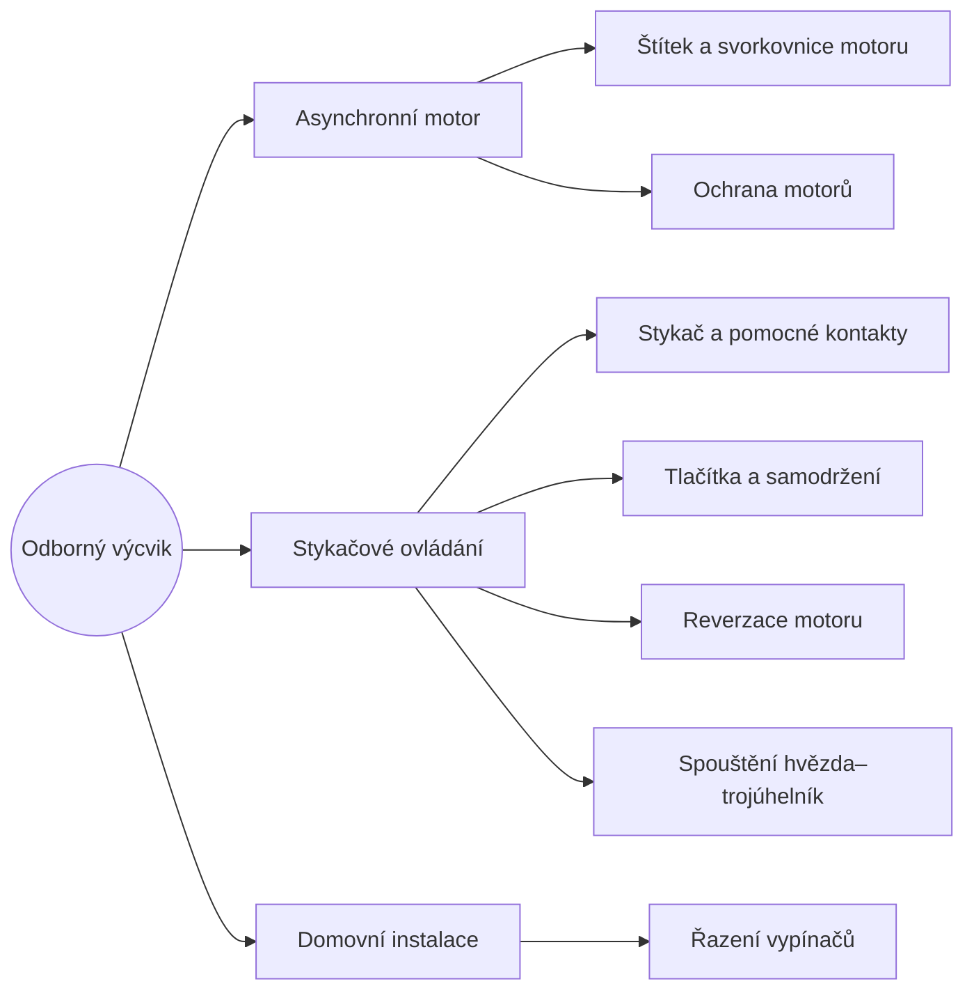

> [!ov] Odborný výcvik
> Praktické zapojování v dílně: stykačové ovládání motorů, ochrana motorů a domovní elektroinstalace.

## 🌳 Strom témat

## 📚 Co se učit (v tomhle pořadí)

> [!karty]
> > [!ov] 1 · [[Asynchronní motor]]
> > Štítek a svorkovnice → Ochrana motorů
>
> > [!ov] 2 · [[Stykačové ovládání]]
> > Stykač → Tlačítka a samodržení → Reverzace → Hvězda–trojúhelník
>
> > [!ov] 3 · [[Domovní instalace]]
> > Řazení vypínačů 1, 5, 6, 7

## 🔧 Vyzkoušej si to

- [Interaktivní schémata](/schemata) – mačkej tlačítka a sleduj, kudy teče proud
- [Simulátor 3F motoru](/simulator) – rozběh, přetížení, výpadek fáze a vybavení ochran v grafech

> [!pamatuj] Bezpečnost v dílně
> Zapojuje se **vždy bez napětí**. Před zapnutím zkontroluje zapojení **učitel / mistr**. Pět pravidel pro práci bez napětí: **vypnout – zajistit proti zapnutí – ověřit, že není napětí – uzemnit a zkratovat – zakrýt sousední živé části**.
