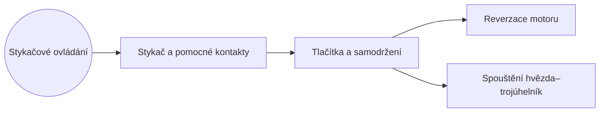

> [!kostka] O čem to je
> Jak ovládat motor **na dálku** tlačítky přes stykač – od jednoduchého impulsního chodu po spouštění hvězda–trojúhelník.

## 🌳 Podtémata

1. [[Stykač a pomocné kontakty]] – cívka, hlavní a pomocné kontakty, značení svorek
2. [[Tlačítka a samodržení]] – Start/Stop, přídržný kontakt, ovládání z více míst
3. [[Reverzace motoru]] – změna smyslu otáčení a blokování
4. [[Spouštění hvězda–trojúhelník]] – omezení záběrného proudu

## Silový × ovládací obvod

> [!definice] Dva obvody
> **Silový (hlavní) obvod** vede proud k motoru: jistič / pojistky → hlavní kontakty stykače → tepelné relé → motor.
> **Ovládací (pomocný) obvod** ovládá cívku stykače: pojistka → 95–96 → tlačítka → pomocné kontakty → cívka A1–A2.

Ovládací obvod bývá na **230 V** (fáze a N) nebo **24 V** z bezpečnostního transformátoru. Ve schématech se kreslí vedle silového obvodu zleva doprava, napájení **nahoře**, nulový vodič **dole**.

> [!tip] Interaktivní schémata
> Všechna zapojení z tohoto tématu si můžeš „proklikat“ v sekci [Schémata](/schemata).

## 🧠 Otestuj se

> [!question]- Jaký je rozdíl mezi silovým a ovládacím obvodem?
> Silový obvod napájí motor (velké proudy), ovládací obvod napájí jen cívky stykačů, signálky a tlačítka (malé proudy).

> [!question]- Kde se ve schématu kreslí nulový vodič ovládacího obvodu?
> Dole – napájení (fáze) je nahoře, cívky a signálky jsou připojené k N dole.
